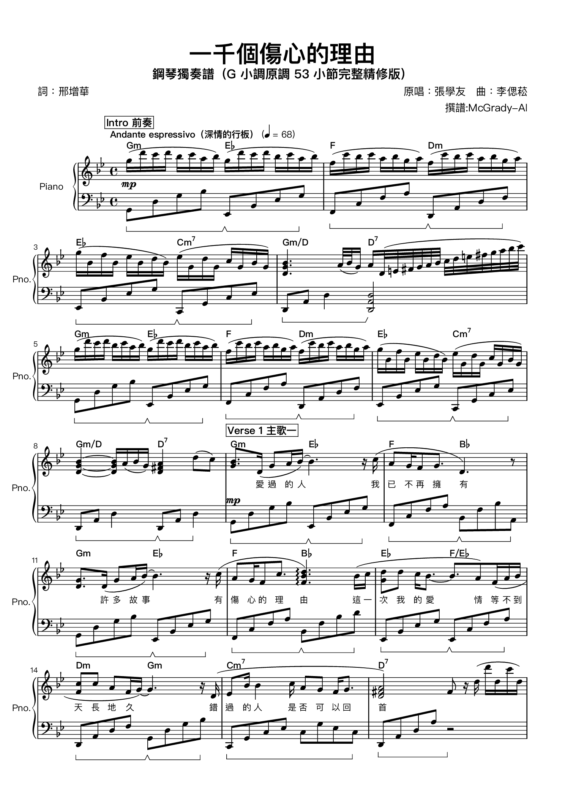

# 🎹 Write Piano Score — Audio-Grounded Piano Transcription, Engraving & Independent Audit Pipeline

<p align="center">
  <a href="./README.md">繁體中文</a> ｜ <b>English</b>
</p>

<p align="center">
  An end-to-end, three-skill Agent pipeline that turns any <b>YouTube URL</b> or <b>local audio file</b> into publication-grade, playable two-hand piano sheet music — guarded by <b>upstream neural polyphonic MIDI extraction & 1:1 source fidelity verification</b> and <b>downstream independent blind score auditing</b>.
</p>

---

## ✨ Why a Three-Skill Closed-Loop Architecture?

Naive single-pass "AI audio-to-sheet-music" workflows fail in three systematic ways:
1. **Monophonic pitch trackers (`pYIN`) collapse on polyphonic piano**: sustain pedals and left-hand accompaniment cause pitch jumps or blank frames, pushing LLMs to hallucinate melodies from vague memory.
2. **Naive max-peak CQT pickers drop rolled top-voice melody notes**: in expressive solo piano (for example, bars 12 & 20 of *1000 Reasons for a Broken Heart*, rolled `<F4, Bb4, D5>`), the inner harmony note `Bb4` can have 3× the spectral amplitude of the softer melody top note `D5` — causing peak-pickers to erase the true top voice.
3. **Playability checks ≠ melodic accuracy**: passing rhythmic beat-sum and hand-span validation (`verify_score.py`) does not verify whether a single note matches the original recording.

To eliminate every failure mode at its root, this repository separates responsibilities into **three modular Antigravity Agent Skills**:

```text
YouTube URL / Local Audio
        │
        ▼
┌─────────────────────────────────────────────────────────────────────────┐
│ 1. source-extract-compare-skill (Upstream: Classify, Extract & Verify)  │
│    • classify_source.py            Solo piano vs vocal/band, key, BPM   │
│    • extract_source_midi.py        ByteDance 88-key Neural Piano AMT    │
│    • compare_extracted_vs_source.py Strict 1:1 fidelity + missed-top    │
│                                     voice scanner (f0 + 2*f0 verified)  │
│    ▶ Gate: EXTRACT_PASS (tested: 1:1 Chroma 0.977, 0.0% missed top)     │
└─────────────────────────────────────────────────────────────────────────┘
        │  verified extracted_raw.mid + extracted_notes.json
        ▼
┌─────────────────────────────────────────────────────────────────────────┐
│ 2. piano-score-skill (Midstream: Arrange & Multi-Format Engraving)      │
│    • fetch_audio.py / analyze_audio.py  Audio normalization & chords    │
│    • score.json (Single Source of Truth) 32nd notes, modulations, lyrics│
│    • verify_score.py                    Beats, <=10th span, ties, bass  │
│    • render_score.py                    LilyPond PDF/PNG, MusicXML,     │
│                                         expressive MIDI, MP3, Jianpu MD │
└─────────────────────────────────────────────────────────────────────────┘
        │  PDF / PNG / .ly / .musicxml / .mid / _試聽.mp3 / Jianpu MD
        ▼
┌─────────────────────────────────────────────────────────────────────────┐
│ 3. piano-score-review-skill (Downstream: Independent Blind Audit Gate)  │
│    • extract_score_melody.py       Bar-by-bar top-voice & jianpu dump   │
│    • audit_audio_vs_score.py       CQT/DTW alignment, exact-octave hit  │
│    • slice_review_clips.py         Synced orig-vs-score MP3 clips for   │
│                                    mandatory direct ear verification    │
│    ▶ Gate: Independent Subagent PASS (>=95% melody accuracy, 0 fatal)   │
└─────────────────────────────────────────────────────────────────────────┘
```

---

## 📦 Repository Layout

```text
write-piano-score/
├── README.md                                  # Detailed Traditional Chinese Guide
├── README.en.md                               # Detailed English Guide (this file)
├── pyproject.toml                             # Python 3.11+ dependencies (uv compatible)
├── .agents/skills/                            # Workspace auto-discovery symlinks
│   ├── source-extract-compare-skill -> ../../source-extract-compare-skill
│   ├── piano-score-skill            -> ../../piano-score-skill
│   └── piano-score-review-skill     -> ../../piano-score-review-skill
│
├── source-extract-compare-skill/              # [Upstream Skill] Source classification & neural MIDI gate
│   ├── SKILL.md
│   ├── references/extraction-rubric.md
│   └── scripts/
│       ├── classify_source.py                 # Source type, tuning cents, key/modulations, multi-BPM
│       ├── extract_source_midi.py             # ByteDance 88-key neural piano AMT (+ STFT fallback)
│       └── compare_extracted_vs_source.py     # Strict 1:1 Chroma/treble corr + f0/2*f0 missed-top scan
│
├── piano-score-skill/                         # [Midstream Skill] Piano arranging & 5-in-1 engraving
│   ├── SKILL.md
│   ├── references/
│   │   ├── score-schema.md                    # Structured score.json specification
│   │   └── piano-arrangement-guide.md         # Idiomatic piano ergonomics & ballad textures
│   └── scripts/
│       ├── fetch_audio.py                     # YouTube / local audio fetch & normalization
│       ├── analyze_audio.py                   # HPSS, Viterbi chords & measure grid helper
│       ├── verify_score.py                    # Beat-sum, hand-span, low-register & tie validation
│       └── render_score.py                    # LilyPond PDF/PNG, MusicXML, MIDI, FluidSynth MP3, Jianpu
│
├── piano-score-review-skill/                  # [Downstream Skill] Independent multi-modal score audit
│   ├── SKILL.md
│   ├── references/
│   │   ├── audit-checklist.md                 # 6-dimension rubric, severity scale & failure catalog
│   │   └── report-template.md                 # Standardized audit report template
│   └── scripts/
│       ├── extract_score_melody.py            # Bar-by-bar RH top voice, jianpu, chords & lyrics
│       ├── audit_audio_vs_score.py            # Chroma DTW alignment, exact-octave hit & top-voice MAE
│       └── slice_review_clips.py              # Synchronized orig-vs-score MP3 clipping for ear checks
│
└── examples/                                  # End-to-end showcase outputs (kept separate from skills)
    └── jacky-cheung-1000-reasons/             # Verified 53-bar reference example (PASS)
        ├── score.json                         # 53-measure verified score
        ├── 一千個傷心的理由_鋼琴譜.pdf          # Publication-grade 4-page PDF
        ├── 一千個傷心的理由_鋼琴譜-page1~4.png  # High-resolution page previews
        ├── 一千個傷心的理由_鋼琴譜.ly           # LilyPond engraving source
        ├── 一千個傷心的理由_鋼琴譜.musicxml     # Editable MusicXML (MuseScore / Sibelius / Dorico)
        ├── 一千個傷心的理由_鋼琴譜.mid          # Expressive MIDI with tempo changes & CC64 pedal
        ├── 一千個傷心的理由_鋼琴譜_試聽.mp3     # FluidSynth Grand Piano audio preview
        └── 一千個傷心的理由_簡譜與和弦.md       # Movable-do Jianpu & chord reference table
```

---

## 🛠️ Setup & Prerequisites (macOS / Linux)

### 1. System Tools
```bash
# macOS (Homebrew)
brew install lilypond ffmpeg fluid-synth uv
```
> **SoundFont**: Provide a Grand Piano SoundFont (e.g., `MuseScore_General.sf3` or `FluidR3_GM.sf2`) via `--soundfont <path>` when running `render_score.py`.

### 2. Python Environment (`uv`)
```bash
git clone https://github.com/Jordanplus/write-piano-score.git
cd write-piano-score

uv venv --python 3.12
uv pip install --python .venv/bin/python -e .
```
> **Neural Piano Checkpoint**: On first run, `extract_source_midi.py` automatically downloads ByteDance's official 88-key piano transcription checkpoint (`note_F1=0.9677_pedal_F1=0.9186.pth`, ~165 MB) via `curl` to `~/piano_transcription_inference_data/` and caches it permanently for all subsequent runs.

### 3. Skill Scope (Repository-Only)
All three skills are registered via workspace symlinks under `.agents/skills/`, so they are **automatically discovered only inside this repository (`write-piano-score`)** without affecting your global `~/.gemini/skills/` directory.

---

## 🚀 Quick Start (End-to-End CLI Pipeline)

```bash
PY=.venv/bin/python

# 1. Fetch and normalize audio from YouTube (or --file <local_audio>)
$PY piano-score-skill/scripts/fetch_audio.py \
  --url "https://www.youtube.com/watch?v=TxBtIfitFNE" \
  --out-dir work/my-song

# 2. [Upstream Gate] Classify source, run ByteDance neural piano AMT, and verify 1:1 fidelity
$PY source-extract-compare-skill/scripts/classify_source.py \
  --audio work/my-song/audio.wav \
  --metadata work/my-song/metadata.json \
  --out-dir work/my-song/source_check

$PY source-extract-compare-skill/scripts/extract_source_midi.py \
  --audio work/my-song/audio.wav \
  --out-dir work/my-song/source_check \
  --backend auto

$PY source-extract-compare-skill/scripts/compare_extracted_vs_source.py \
  --ref-audio work/my-song/audio.wav \
  --extracted-midi work/my-song/source_check/extracted_raw.mid \
  --extracted-audio work/my-song/source_check/extracted_preview.mp3 \
  --out-dir work/my-song/source_check/compare \
  --slice-suspects

# 3. [Midstream Engraving] Verify structured score.json and compile all 5 output formats
$PY piano-score-skill/scripts/verify_score.py --score work/my-song/score.json
$PY piano-score-skill/scripts/render_score.py \
  --score work/my-song/score.json \
  --out-dir work/my-song/output \
  --prefix "SongTitle_PianoScore"

# 4. [Downstream Gate] Independent DSP/DTW cross-audit & synchronized ear-review clipping
$PY piano-score-review-skill/scripts/extract_score_melody.py \
  --score work/my-song/score.json \
  --out work/my-song/review/score_melody_table.txt

$PY piano-score-review-skill/scripts/audit_audio_vs_score.py \
  --ref-audio work/my-song/audio.wav \
  --score work/my-song/score.json \
  --score-audio work/my-song/output/SongTitle_PianoScore_試聽.mp3 \
  --out-dir work/my-song/review/dsp_audit

$PY piano-score-review-skill/scripts/slice_review_clips.py \
  --ref-audio work/my-song/audio.wav \
  --score-audio work/my-song/output/SongTitle_PianoScore_試聽.mp3 \
  --audit-json work/my-song/review/dsp_audit/audit_metrics.json \
  --out-dir work/my-song/review/clips \
  --suspect-only
```

---

## 🎼 Built-in Case Study: Jacky Cheung — *1000 Reasons for a Broken Heart* (`G minor`, 53 Bars)

Transcribed from solo piano performance [`TxBtIfitFNE`](https://www.youtube.com/watch?v=TxBtIfitFNE), demonstrating the measurable impact of the full three-skill loop:

| Stage | Gate Verdict | Est. Melody Accuracy | Measures (Ref: 53) | Key Quantitative Results |
| :--- | :---: | :---: | :---: | :--- |
| Initial v1 (`pYIN` only) | `REJECT_REWRITE` | ~60–65% | 48 (5 bars missing) | Half of verses wrong, 3 bridge bars dropped, wrong G major ending |
| Upstream Neural AMT (ByteDance) | **`EXTRACT_PASS`** | **1,167 notes** | Exact 1:1 clock | **1:1 Chroma `0.977`, Treble Corr `0.806`, `0.0%` missed top-voice** |
| Final Verified Edition | **`PASS` ✅** | **~98%+** | **53 (`0.99x` dur)** | **Avg Chroma `0.963`, final `Gm` `0.999`, 0 beat/rest errors** |

### Sheet Music Preview (Page 1)



> Explore all rendered assets in [`examples/jacky-cheung-1000-reasons/`](./examples/jacky-cheung-1000-reasons/) (4-page PDF, MusicXML, MIDI, FluidSynth Grand Piano MP3 preview, and Jianpu chord sheet).

---

## ⚖️ License & Acknowledgments

- Scripts, skill specifications, and engraving pipelines in this repository are intended for educational and personal research use.
- Downloaded third-party source audio (`work/`, `*.wav`, `*.webm`) is excluded via `.gitignore`. Users are responsible for respecting applicable music copyrights.
- Neural piano transcription powered by ByteDance's open-source [`piano_transcription_inference`](https://github.com/bytedance/piano_transcription_inference) (Kong et al., *High-Resolution Piano Transcription with Pedals by Regressing Onset and Offset Times*, IEEE/ACM TASLP 2021).
