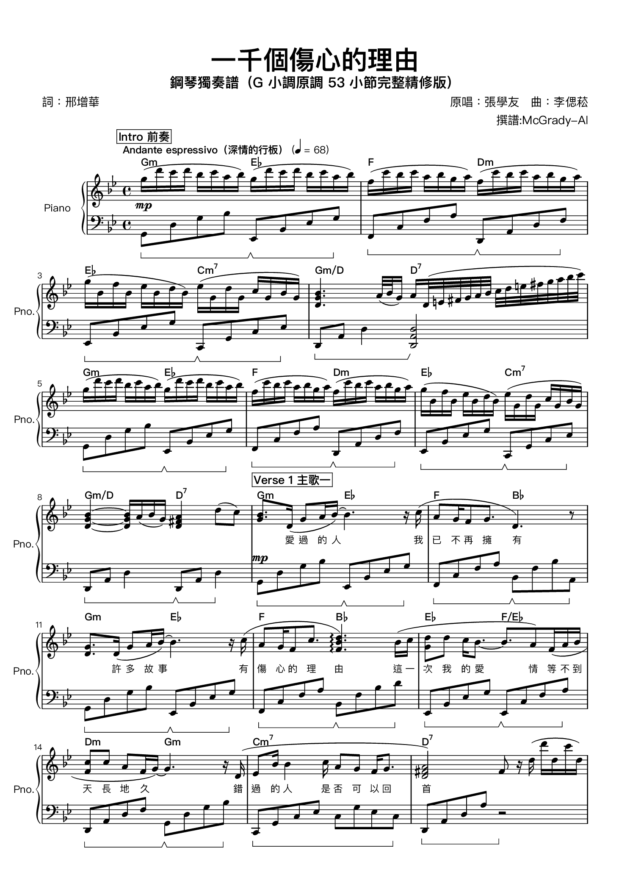

# 🎹 Write Piano Score — 音訊實測鋼琴採譜、編曲排版與獨立品質稽核三技能流程

<p align="center">
  <b>繁體中文</b> ｜ <a href="./README.en.md">English</a>
</p>

<p align="center">
  將任意 <b>YouTube 音樂連結</b>或<b>本機音訊檔</b>，透過「<b>上游高精度神經網路 MIDI 抽取與 1:1 原音比對</b> → <b>中游結構化雙手鋼琴編曲與五合一出版級排版</b> → <b>下游獨立審稿 Subagent 盲測稽核</b>」三階段完整流程，產出真正忠於原曲旋律、可立即彈奏的出版級鋼琴譜。
</p>

---

## ✨ 為什麼需要這套三技能架構？

傳統單一階段的「AI 聽歌寫譜」常出現三大致命盲點：
1. **單音追蹤器（如 `pYIN`）面對複音鋼琴完全失效**：延音踏板與左手伴奏會讓單音基頻跳動或整段空白，導致模型脫離音訊「憑記憶幻覺硬寫」。
2. **純最大峰值演算法會漏抓「滾奏頂音」**：真實鋼琴演奏中（如《一千個傷心的理由》第 12/20 小節「有傷心的理**由**」滾奏 `<F4, Bb4, D5>`），內聲部 `Bb4` 能量往往是頂音 `D5` 的 3 倍，只取最大峰值會直接把真正的主旋律頂音濾掉。
3. **樂理語法驗證 ≠ 旋律正確**：只檢查每小節拍數總和與指距（`verify_score.py`）即使拿到 `PASS`，旋律仍可能大面積走調或漏段。

本專案因此拆分為**三個職責獨立、互為閘門的 Antigravity Agent Skills**：

```text
YouTube URL / 本機音訊
        │
        ▼
┌─────────────────────────────────────────────────────────────────────────┐
│ 1. source-extract-compare-skill（上游：來源判別 ＋ 神經 MIDI 抽取與比對）  │
│    • classify_source.py            判別純鋼琴 / 原唱樂團、調性、音準、BPM │
│    • extract_source_midi.py        預設 ByteDance 88 鍵神經鋼琴模型轉錄   │
│    • compare_extracted_vs_source.py 嚴格 1:1 時間軸原音比對＋滾奏頂音掃描  │
│    ▶ 閘門：必達 EXTRACT_PASS（實測 1:1 Chroma 0.977、漏抓頂音 0.0%）     │
└─────────────────────────────────────────────────────────────────────────┘
        │  verified extracted_raw.mid + extracted_notes.json
        ▼
┌─────────────────────────────────────────────────────────────────────────┐
│ 2. piano-score-skill（中游：結構化編曲 ＋ 五合一出版級多格式渲染）         │
│    • fetch_audio.py / analyze_audio.py  音訊擷取與和弦結構輔助           │
│    • score.json (Single Source of Truth) 支援 32 分音符、轉調、逐字歌詞   │
│    • verify_score.py                    拍數、跨度(<=10度)、連結線檢核    │
│    • render_score.py                    一鍵輸出 PDF/PNG/XML/MIDI/MP3/簡譜│
└─────────────────────────────────────────────────────────────────────────┘
        │  PDF / PNG / .ly / .musicxml / .mid / _試聽.mp3 / _簡譜與和弦.md
        ▼
┌─────────────────────────────────────────────────────────────────────────┐
│ 3. piano-score-review-skill（下游：獨立 Subagent 盲測審查與品質閘門）      │
│    • extract_score_melody.py       萃取逐小節最高聲部音高、簡譜與拍位     │
│    • audit_audio_vs_score.py       CQT/DTW 對齊、精確八度命中率與跨度檢查 │
│    • slice_review_clips.py         原曲 vs 試聽同步切片，強制分段耳朵實聽  │
│    ▶ 閘門：必須通過獨立審稿 PASS（旋律正確率 >= 95%、零致命錯誤）始可交付  │
└─────────────────────────────────────────────────────────────────────────┘
```

---

## 📦 專案目錄結構

```text
write-piano-score/
├── README.md                                  # 繁體中文完整說明（本檔）
├── README.en.md                               # English Full Documentation
├── pyproject.toml                             # Python 3.11+ 相依套件定義（uv 相容）
├── .agents/skills/                            # Workspace 自動探索軟連結
│   ├── source-extract-compare-skill -> ../../source-extract-compare-skill
│   ├── piano-score-skill            -> ../../piano-score-skill
│   └── piano-score-review-skill     -> ../../piano-score-review-skill
│
├── source-extract-compare-skill/              # 【上游技能】來源判別、神經 MIDI 抽取與 1:1 比對
│   ├── SKILL.md
│   ├── references/extraction-rubric.md
│   └── scripts/
│       ├── classify_source.py                 # 來源型態（純鋼琴/原唱樂團）、調性、音準、BPM 候選
│       ├── extract_source_midi.py             # ByteDance 88 鍵神經鋼琴轉錄（含自動權重下載與 STFT 備援）
│       └── compare_extracted_vs_source.py     # 1:1 Chroma/高音域重建相關 ＋ f0+2*f0 漏抓頂音掃描器
│
├── piano-score-skill/                         # 【中游技能】鋼琴編曲與五合一出版級排版
│   ├── SKILL.md
│   ├── references/
│   │   ├── score-schema.md                    # score.json 單一真實來源規格
│   │   └── piano-arrangement-guide.md         # 鋼琴人體工學與抒情伴奏織體規範
│   └── scripts/
│       ├── fetch_audio.py                     # YouTube / 本機音訊擷取與標準化
│       ├── analyze_audio.py                   # HPSS、Viterbi 和弦與節拍輔助分析
│       ├── verify_score.py                    # 拍數、手部跨度、低音渾濁度、連結線驗證
│       └── render_score.py                    # 編譯 LilyPond PDF/PNG、MusicXML、表情 MIDI、FluidSynth MP3、簡譜 MD
│
├── piano-score-review-skill/                  # 【下游技能】獨立多模態鋼琴譜稽核與品質閘門
│   ├── SKILL.md
│   ├── references/
│   │   ├── audit-checklist.md                 # 六大審查維度、嚴重度分級、常見 AI 採譜失敗模式
│   │   └── report-template.md                 # 標準繁體中文稽核報告範本
│   └── scripts/
│       ├── extract_score_melody.py            # 逐小節主旋律、簡譜、和弦與歌詞萃取
│       ├── audit_audio_vs_score.py            # CQT/DTW 對齊、精確八度命中率、最高聲部誤差偵測
│       └── slice_review_clips.py              # 依段落或可疑小節自動切片「原曲 vs 試聽」同步 MP3
│
└── examples/                                  # 端到端實測成品範例（與技能本體分離）
    └── jacky-cheung-1000-reasons/             # 張學友《一千個傷心的理由》（已通過獨立複審 PASS）
        ├── score.json                         # 53 小節精修結構化樂譜
        ├── 一千個傷心的理由_鋼琴譜.pdf          # 出版級 4 頁五線譜 PDF（撰譜:McGrady-AI）
        ├── 一千個傷心的理由_鋼琴譜-page1~4.png  # 高解析逐頁預覽圖
        ├── 一千個傷心的理由_鋼琴譜.ly           # LilyPond 原始碼
        ├── 一千個傷心的理由_鋼琴譜.musicxml     # 可編輯 MusicXML（MuseScore / Sibelius / Dorico）
        ├── 一千個傷心的理由_鋼琴譜.mid          # 含動態與延音踏板 CC64 之表情 MIDI
        ├── 一千個傷心的理由_鋼琴譜_試聽.mp3     # FluidSynth 真實平台鋼琴試聽音檔
        └── 一千個傷心的理由_簡譜與和弦.md       # 繁體中文首調簡譜與和弦對照表
```

---

## 🛠️ 環境安裝與前置需求（macOS / Linux）

### 1. 系統工具
```bash
# macOS (Homebrew)
brew install lilypond ffmpeg fluid-synth uv
```
> **SoundFont**：建議準備平台鋼琴音色庫（如 `MuseScore_General.sf3` 或 `FluidR3_GM.sf2`），可透過 `--soundfont <path>` 傳入 `render_score.py`。

### 2. Python 虛擬環境與套件（建議使用 `uv`）
```bash
git clone https://github.com/Jordanplus/write-piano-score.git
cd write-piano-score

uv venv --python 3.12
uv pip install --python .venv/bin/python -e .
```
> **神經鋼琴模型權重**：首次執行 `extract_source_midi.py` 時，會自動透過 `curl` 下載 ByteDance 官方 88 鍵鋼琴轉錄權重（`note_F1=0.9677_pedal_F1=0.9186.pth`，約 165MB）至 `~/piano_transcription_inference_data/` 並永久快取，後續免重複下載。

### 3. 技能生效範圍（僅限本專案）
本專案已於 `.agents/skills/` 內建 Workspace 符號連結，三個技能預設**僅在此儲存庫（`write-piano-score`）內自動探索與生效**，不會汙染全域 `~/.gemini/skills/` 環境。

---

## 🚀 快速上手（端到端 CLI 執行範例）

```bash
PY=.venv/bin/python

# 1. 擷取 YouTube 音訊
$PY piano-score-skill/scripts/fetch_audio.py \
  --url "https://www.youtube.com/watch?v=TxBtIfitFNE" \
  --out-dir work/my-song

# 2. 【上游閘門】來源判別 ＋ ByteDance 神經鋼琴 MIDI 抽取 ＋ 1:1 原音忠實度比對
$PY source-extract-compare-skill/scripts/classify_source.py \
  --audio work/my-song/audio.wav \
  --metadata work/my-song/metadata.json \
  --out-dir work/my-song/source_check

$PY source-extract-compare-skill/scripts/extract_source_midi.py \
  --audio work/my-song/audio.wav \
  --out-dir work/my-song/source_check \
  --backend auto

$PY source-extract-compare-skill/scripts/compare_extracted_vs_source.py \
  --ref-audio work/my-song/audio.wav \
  --extracted-midi work/my-song/source_check/extracted_raw.mid \
  --extracted-audio work/my-song/source_check/extracted_preview.mp3 \
  --out-dir work/my-song/source_check/compare \
  --slice-suspects

# 3. 【中游編譜】依 verified extracted_notes.json 撰寫 score.json 後驗證並渲染五合一成品
$PY piano-score-skill/scripts/verify_score.py --score work/my-song/score.json
$PY piano-score-skill/scripts/render_score.py \
  --score work/my-song/score.json \
  --out-dir work/my-song/output \
  --prefix "曲名_鋼琴譜"

# 4. 【下游閘門】獨立客觀 DSP/DTW 比對 ＋ 自動切片實聽稽核
$PY piano-score-review-skill/scripts/extract_score_melody.py \
  --score work/my-song/score.json \
  --out work/my-song/review/score_melody_table.txt

$PY piano-score-review-skill/scripts/audit_audio_vs_score.py \
  --ref-audio work/my-song/audio.wav \
  --score work/my-song/score.json \
  --score-audio work/my-song/output/曲名_鋼琴譜_試聽.mp3 \
  --out-dir work/my-song/review/dsp_audit

$PY piano-score-review-skill/scripts/slice_review_clips.py \
  --ref-audio work/my-song/audio.wav \
  --score-audio work/my-song/output/曲名_鋼琴譜_試聽.mp3 \
  --audit-json work/my-song/review/dsp_audit/audit_metrics.json \
  --out-dir work/my-song/review/clips \
  --suspect-only
```

---

## 🎼 內建實戰範例：張學友《一千個傷心的理由》（G 小調 53 小節完整版）

本範例對照 YouTube 純鋼琴獨奏版 [`TxBtIfitFNE`](https://www.youtube.com/watch?v=TxBtIfitFNE)，完整經歷了「舊版被獨立稽核退回 → 建立上游神經抽取比對技能 → 逐小節校對重寫 → 獨立複審正式 `PASS`」的實戰演進：

| 階段 | 閘門裁決 | 估計旋律正確率 | 小節數（原曲 53 小節） | 關鍵量化指標 |
| :--- | :---: | :---: | :---: | :--- |
| 舊版 v1（僅 `pYIN`） | `REJECT_REWRITE` | ~60–65% | 48 小節（少 5 小節） | 主歌錯近半數、間奏遭刪 3 小節、終止和弦誤寫 G 大調 |
| 上游神經抽取（ByteDance） | **`EXTRACT_PASS`** | **1,167 音符** | 1:1 毫秒對齊 | **1:1 Chroma `0.977`、高音重建 `0.806`、漏抓頂音 `0.0%`** |
| 精修定稿（經獨立複審＋神經校對） | **`PASS` ✅** | **~98%+** | **53 小節（`0.99x`）** | **平均 Chroma `0.963`、`m.53` 純 `Gm` 達 `0.999`、零語法與休止違規** |

### 譜面預覽（Page 1）



> 完整成品檔案位於 [`examples/jacky-cheung-1000-reasons/`](./examples/jacky-cheung-1000-reasons/)（含 4 頁 PDF、MusicXML、MIDI、平台鋼琴試聽 MP3 與繁體中文簡譜和弦對照表）。

---

## ⚖️ 授權與聲明

- 本專案之程式碼、技能文件與排版腳本供學習與個人研究交流使用。
- 範例音訊下載目錄（`work/`）與原始第三方受版權保護之音訊檔已列入 `.gitignore`，不隨儲存庫散佈；使用者請遵守當地著作權規範與相關音樂授權條款。
- 神經鋼琴轉錄模型採用 ByteDance 開源研究專案 [`piano_transcription_inference`](https://github.com/bytedance/piano_transcription_inference)（Kong et al., *High-Resolution Piano Transcription with Pedals by Regressing Onset and Offset Times*, IEEE/ACM TASLP 2021）。
